<!--
README for the public GitHub showcase repository (not the source code).
Set up the repo with the images it references:
  mkdir -p assets/cards && cp docs/marketing/assets/cover-1270x760.jpg assets/ \
    && cp docs/marketing/assets/screenshots/editor.png assets/ \
    && cp docs/marketing/assets/cards-1200x630/*.jpg assets/cards/
Suggested repo name: picsdo/picsdo (or picsdo/ai-image-editor)
About: "Picsdo – AI image editor. Edit any photo by describing the change in your own words."
Website: https://picsdo.com
Topics: ai-image-editor, ai-photo-editor, background-remover, object-remover, watermark-remover,
  photo-restoration, ai-headshot-generator, photo-to-anime, image-to-image, outpainting,
  product-photography, text-to-image, image-editing
-->

<a href="https://picsdo.com">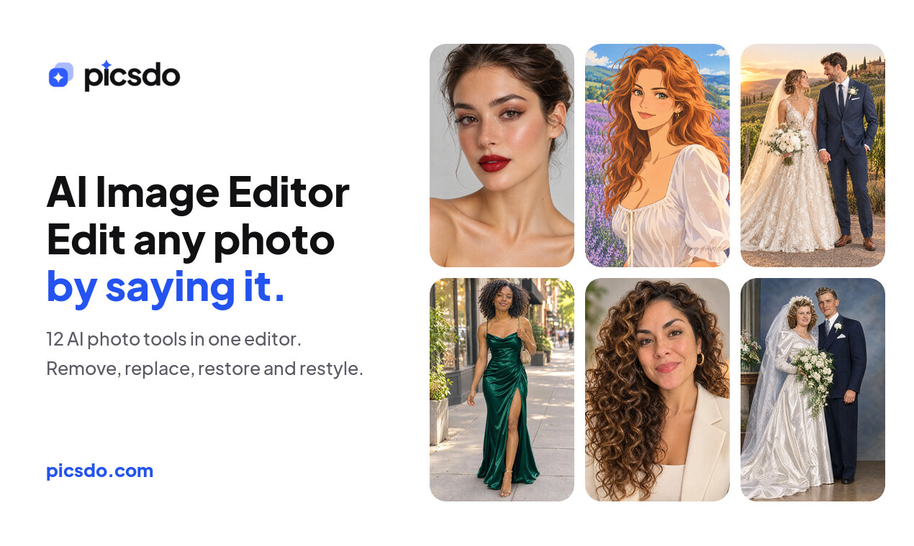</a>

# Picsdo – AI Image Editor

**Edit any photo by describing the change in your own words.**

Remove objects, replace backgrounds, restore old photos, create headshots or turn a portrait into anime, all in one browser-based editor.

[**Try it free →**](https://picsdo.com) · [Tools](#tools) · [Examples](#examples) · [Pricing](#pricing) · [FAQ](#faq)

---

## Why Picsdo

Most photo edits are easy to describe and slow to do by hand. Removing one stranger from a travel photo usually means a lasso selection, a clone stamp and a lot of patience. With Picsdo you upload a photo, write what should change, and download the edited image.

- **Describe, don't select.** Type an instruction such as *"remove the person in the red jacket"* or *"put her on a beach at golden hour"*. Prompts can be written in any language.
- **12 tools in one editor.** Dedicated tools with presets for the most common jobs, sharing one credit balance.
- **Brush when you need precision.** The object and watermark removers let you paint exactly what should go.
- **Watermark-free downloads.** PNG output, with transparent PNGs for background removal.
- **Private and commercial-ready.** Uploads stay private, and you can use results commercially when you own the original photo.
- **Free to try.** 3 edits without an account, 25 free credits when you sign up.

## Tools

| Tool | What it does |
| --- | --- |
| [AI Image Editor](https://picsdo.com/) | Edit a photo with a text prompt, or create an image from text |
| [AI Background Remover](https://picsdo.com/ai-background-remover) | Cut out people and products as transparent PNGs |
| [AI Object Remover](https://picsdo.com/ai-object-remover) | Brush over people or objects; the scene is filled in from its surroundings |
| [AI Watermark Remover](https://picsdo.com/ai-watermark-remover) | Remove text, logos and date stamps from your own photos |
| [AI Background Changer](https://picsdo.com/ai-background-changer) | Place a subject in a studio, city, beach, forest or custom scene |
| [Photo Restoration](https://picsdo.com/photo-restoration) | Repair scratches, tears and fading, with optional colorization |
| [AI Headshot Generator](https://picsdo.com/ai-headshot-generator) | Turn a selfie into a corporate, studio, office, outdoor or creative headshot |
| [Photo to Anime](https://picsdo.com/photo-to-anime) | Restyle portraits, couples and pets as anime, manga or chibi art |
| [Image to Image AI](https://picsdo.com/image-to-image) | Turn a photo into an oil painting, 3D render, pixel art, sketch or custom style |
| [AI Clothes Changer](https://picsdo.com/ai-clothes-changer) | Try a suit, smart casual, evening wear, streetwear or any outfit you describe |
| [AI Image Extender](https://picsdo.com/ai-image-extender) | Extend a photo to square, vertical 9:16 or widescreen 16:9 |
| [AI Product Photo Generator](https://picsdo.com/ai-product-photo) | Put a product into studio or lifestyle scenes for listings and ads |

## Examples

All examples were made with Picsdo. The prompt used is shown under each image.

| | |
| --- | --- |
| <a href="https://picsdo.com/">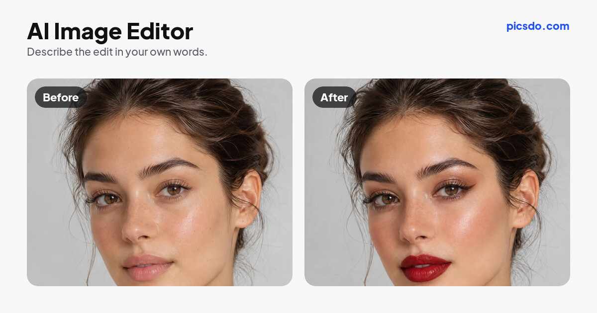</a> **AI Image Editor** – *"Glam evening makeup with red lips and soft winged eyeliner."* | <a href="https://picsdo.com/ai-background-changer">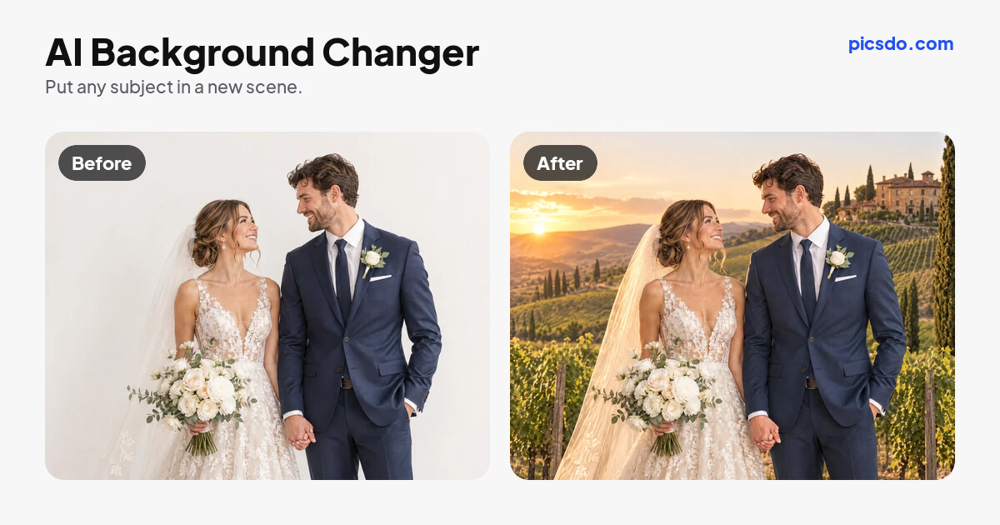</a> **Background Changer** – *"A Tuscan vineyard at golden hour with rolling hills."* |
| <a href="https://picsdo.com/photo-to-anime">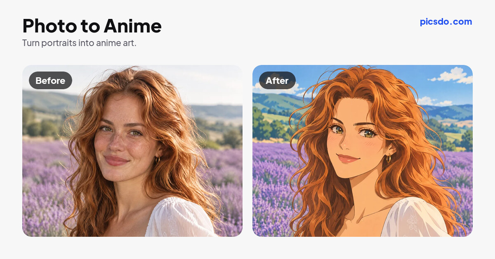</a> **Photo to Anime** – *"Keep the lavender field and her auburn hair."* | <a href="https://picsdo.com/ai-headshot-generator">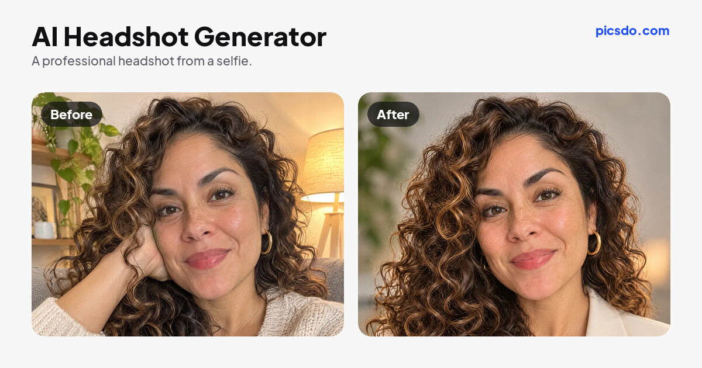</a> **Headshot Generator** – *"A cream blazer and a warm, friendly smile."* |
| <a href="https://picsdo.com/photo-restoration">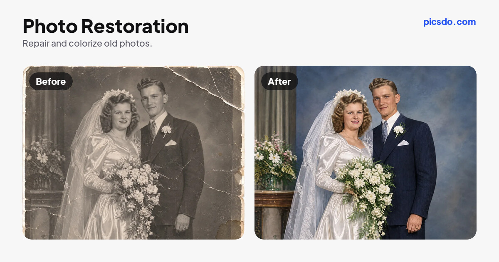</a> **Photo Restoration** – *"Repair the cracks and colorize the portrait."* | <a href="https://picsdo.com/ai-object-remover">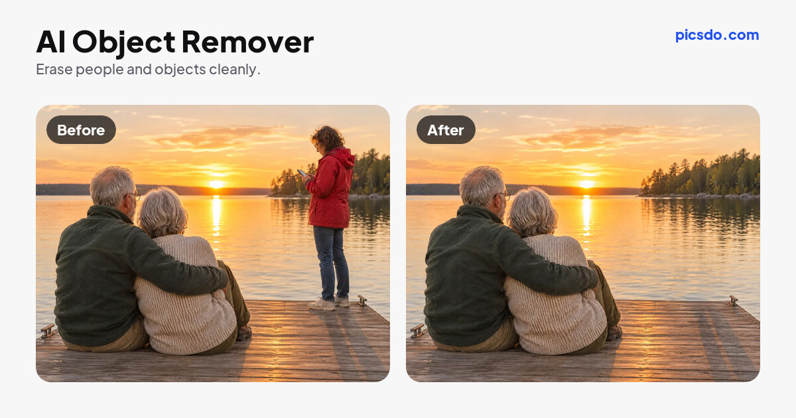</a> **Object Remover** – *"Remove the person in the red jacket."* |
| <a href="https://picsdo.com/ai-background-remover">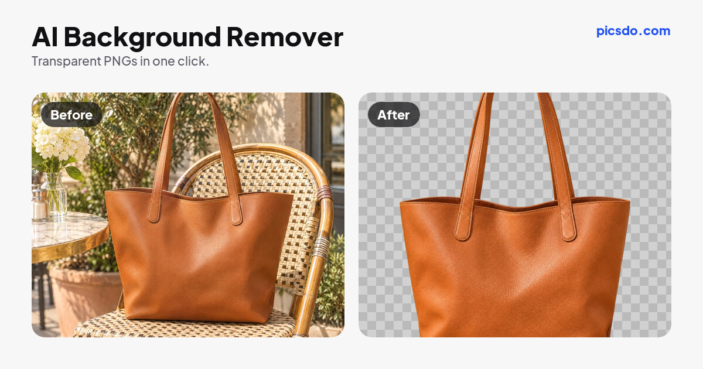</a> **Background Remover** – *"Remove the background and keep the whole bag."* | <a href="https://picsdo.com/ai-watermark-remover">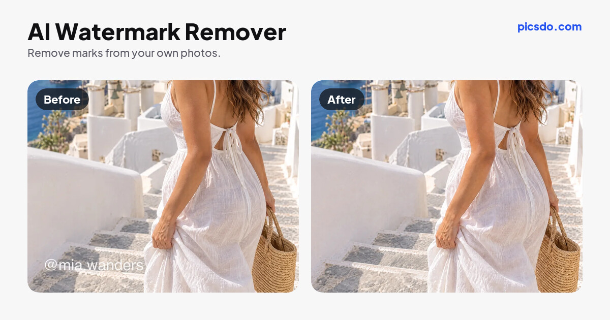</a> **Watermark Remover** – *"Remove my handle from the corner."* |
| <a href="https://picsdo.com/ai-clothes-changer">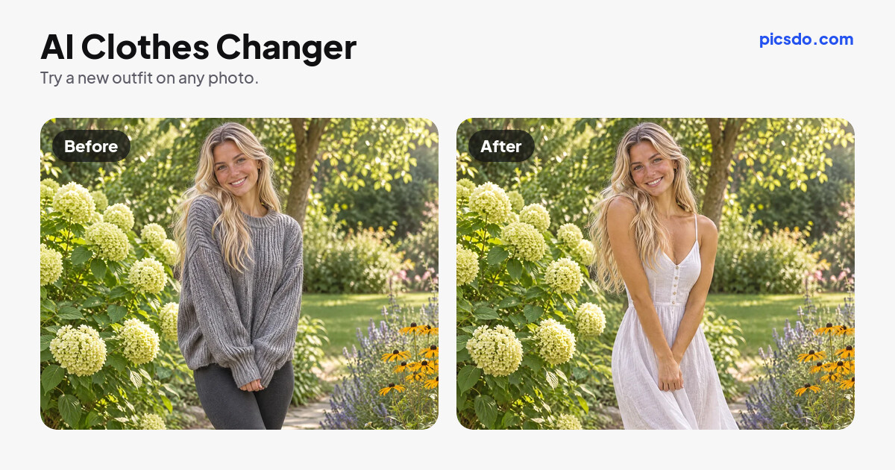</a> **Clothes Changer** – *"A flowing white linen summer dress."* | <a href="https://picsdo.com/ai-product-photo">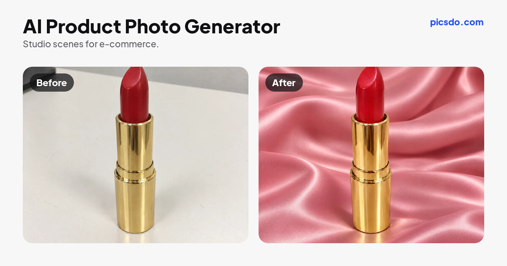</a> **Product Photo** – *"On draped pink silk with soft shadows."* |

## How it works

1. **Upload a photo** (JPG, PNG or WebP) or start from text.
2. **Pick a tool or describe the edit.** Choose a preset, paint a mask, or write an instruction in any language.
3. **Choose the format.** Auto or one of 7 aspect ratios (1:1, 4:3, 3:4, 3:2, 2:3, 16:9, 9:16), in Standard or HD quality.
4. **Download or keep editing.** Save a watermark-free PNG, compare it with the original, or use the result as the next input.

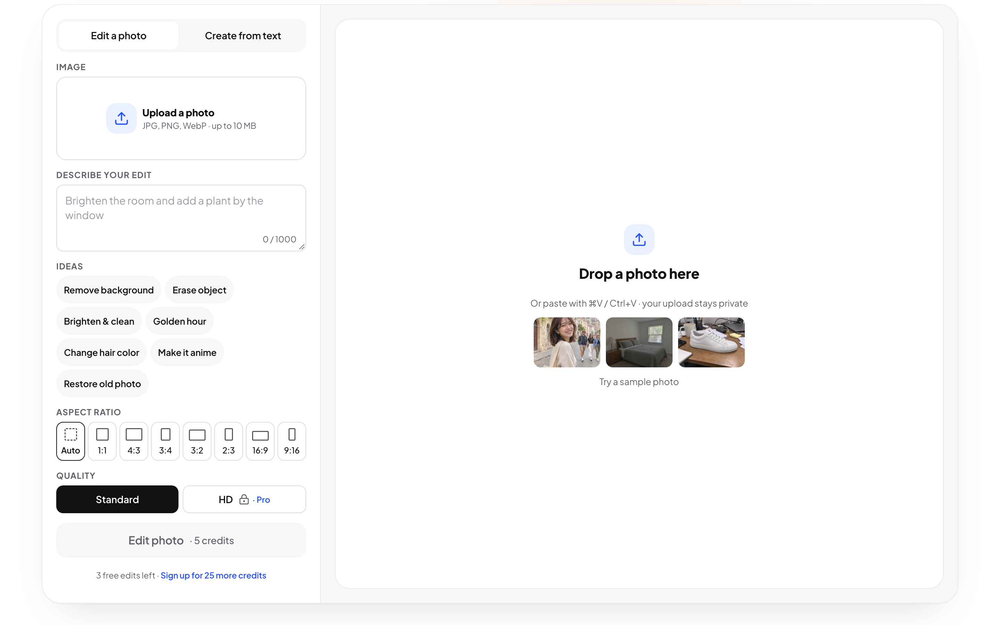

## Use cases

- **E-commerce:** transparent product cutouts and lifestyle scenes for listings and ads
- **Careers:** LinkedIn and resume headshots from a casual selfie
- **Social media:** new backgrounds, outfits, anime avatars and vertical crops for Stories
- **Family archives:** repair and colorize old prints and scans
- **Travel and real estate:** remove people, signs and clutter from photos

## Pricing

| Plan | Price | Credits |
| --- | --- | --- |
| Free | $0 | 3 edits without sign-up, 25 credits on sign-up |
| Pro | $18 / month | 1,000 / month |
| Max | $38 / month | 2,400 / month |
| Ultra | $78 / month | 5,400 / month |

A Standard image costs 5 credits and an HD image 15 credits (HD on paid plans). Yearly plans are available. See [picsdo.com/pricing](https://picsdo.com/pricing) for current details.

## FAQ

**Do I need to install anything?**
No. Picsdo runs in any modern desktop or mobile browser.

**Which languages can I use for prompts?**
Any. The interface is in English, but you can describe edits in your own language.

**Is there a watermark on downloads?**
No. Every download is a clean PNG.

**Can I use the results commercially?**
Yes, as long as you have the rights to the photos you upload. See the [Terms](https://picsdo.com/terms) and [Acceptable Use Policy](https://picsdo.com/acceptable-use).

**What happens to my uploads?**
Uploads are private to your account. Free-plan images are kept for 7 days; paid plans keep your history. See the [Privacy Policy](https://picsdo.com/privacy).

**Can I remove watermarks from any image?**
Only from photos you own or have permission to edit. Removing watermarks or credits from other people's work is not allowed.

## About this repository

This repository is the public home of Picsdo on GitHub: product information, examples and feedback. Picsdo itself is a hosted web app at [picsdo.com](https://picsdo.com); this repository does not contain its source code.

Found a bug or have a feature request? [Open an issue](../../issues).

---

**[picsdo.com](https://picsdo.com)** · AI image editor

